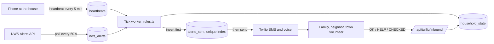
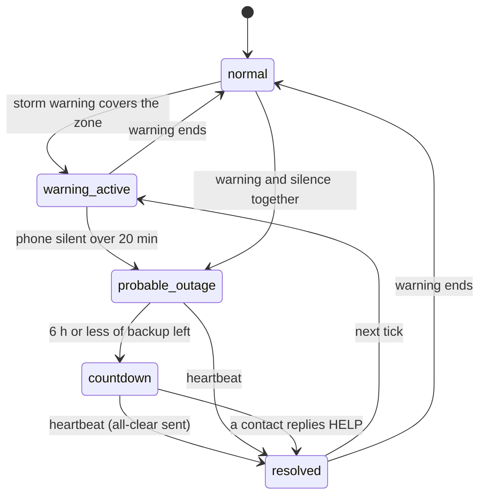

# Pilot Light

Pilot Light counts down a medically dependent rural senior's backup-battery hours during a winter power outage and texts and calls their family, a neighbor, and their town before the clock runs out.

The family member runs the app. The senior's side is a text or a phone call, nothing else.

## Run it

Needs Node 20+ and Postgres.

```bash
cp .env.example .env.local     # set DATABASE_URL; Twilio keys are optional
createdb pilot_light
npm install
npm run setup                  # migrate + seed one Ossipee household and the storm scenario
npm run replay                 # the whole chain, in the terminal, in about 2 minutes
```

`npm run replay` injects a real archived storm warning, silences the household phone, speeds the clock up 120x and prints each state change and message as it happens. Add `--assert` to check the result, `--speed 30` to slow it down.

For the app itself:

```bash
npm run dev                    # web on :3000 plus the background worker
```

- `/replay` is the one-click demo: Run, watch the countdown, Reset.
- `/h/00000000-0000-4000-8000-000000000001` is the seeded household's status screen.
- `/h/new` sets up a household.
- `/town/Ossipee` is the volunteer roster.

Without Twilio keys every message is logged as `SIMULATED` and nothing is sent. To make real phones ring, set `TWILIO_ACCOUNT_SID`, `TWILIO_AUTH_TOKEN`, `TWILIO_FROM` and the `SEED_PHONE_*` numbers, rerun `npm run db:seed`, expose the app with a tunnel, set `PUBLIC_BASE_URL` to the tunnel address, and point the Twilio number's incoming-message webhook at `PUBLIC_BASE_URL/api/twilio/inbound`.

## How it works





The server never knows the power is out. It infers it from two signals agreeing: an active NWS warning over the household's zone, and the household phone going silent. Either alone does nothing. Both together for 20 minutes start a clock from the shortest backup among the household's devices, and the ladder fires at 6 hours, 2 hours and zero.

Pilot Light has to keep working during the event that takes down its own infrastructure, so it is built to assume its own failure:

1. **Inference from silence.** A dead-man's switch on the server; the household does nothing. `src/lib/engine/rules.ts`
2. **SMS and voice as the transport of last resort.** No app or push notification on the receiving end. `src/lib/twilio.ts`, `src/lib/messages.ts`
3. **Store-and-forward on the phone.** Heartbeats and battery edits made offline wait in IndexedDB and send when a connection returns. `src/lib/client/queue.ts`
4. **Idempotent delivery.** A unique index plus a claim lease means racing workers cannot text a family twice. `src/lib/engine/tick.ts`

Storm replay fakes the storm, not the system: it changes the alert, the heartbeat history and the clock speed, and the rules have no replay branch. `src/lib/replay.ts`

## Code map

| Path | What it is |
|---|---|
| `src/lib/engine/rules.ts` | The seven outage rules as pure functions |
| `src/lib/engine/tick.ts` | Loads households, applies the rules, delivers alerts |
| `src/lib/inbound.ts` | OK / HELP / CHECKED / STOP replies and voice key presses |
| `src/lib/nws.ts` | NWS alert poller, zone lookup, geocoder |
| `src/lib/replay.ts` | Storm replay run and reset |
| `src/db/schema.ts` | Tables |
| `src/app/api/` | Route handlers, including the Twilio webhooks |
| `src/components/` | Setup form, status screen, replay console, roster, map |
| `public/sw.js` | Offline shell and background heartbeat |
| `scripts/` | Worker, seed, migrate, replay CLI, one-time data pulls |
| `tests/rules.test.ts` | Rule tests against fixtures |
| `docs/decisions.md` | Dated decisions and why |

## Data sources

| Source | Use |
|---|---|
| [NWS Alerts API](https://www.weather.gov/documentation/services-web-api) `alerts/active?area=NH` | Live trigger, polled every 60 s |
| NWS `points/{lat},{lng}` | Household's forecast zone, resolved once at save |
| [Iowa Environmental Mesonet](https://mesonet.agron.iastate.edu/vtec/?year=2025&wfo=KGYX&phenomena=WS&significance=W&eventid=0007) | Archive of the Dec 28, 2025 NWS warning used by the replay |
| [NH GRANIT](https://nhgeodata.unh.edu/hosting/rest/services/Hosted) Political_Boundaries, NH_CAI_Locations | Town outlines; fire/rescue, hospital and urgent-care sites. Pulled once by `scripts/fetch-granit.mjs` into `public/data/` |
| OpenStreetMap Nominatim | Address to coordinates |
| `src/data/utilities.json` | Utility registration links and a 10-town utility guess, hand-built and marked unverified |

## Limits, stated plainly

- **Background heartbeats do not run on iPhones.** The phone at the house checks in every 5 minutes while the status page is open. Chrome on Android can also check in every 15 minutes in the background once installed. iOS Safari cannot, so an iPhone must keep the page open.
- **Silence is weak evidence.** A phone can go quiet because it died or lost Wi-Fi. That is why every alert asks the family to confirm, and why a warning must also be in force.
- **Backup hours are estimates.** The defaults are starting points to be replaced with the figure for the actual equipment. Electric heat and a stationary concentrator default to none.
- **No login yet.** A household is reached by its unguessable link; `/replay` and the roster need `ADMIN_TOKEN` in production.
- **The utility-by-town list is a guess** until each row is confirmed with the utility.
- **Replay speeds up one shared clock.** Do not run it while real households are being monitored.
- Pilot Light is not a medical device and does not replace 911. Every message says to call 911 for an emergency.

## Checks

```bash
npm test             # the rules, against fixtures
npm run test:replay  # the full chain against Postgres with simulated transport
npm run lint && npm run typecheck && npm run build
```

## AI disclosure

This code was written with Claude Code from the team's build spec. Files it wrote carry an `// AI-assisted:` header. No AI runs in the product.
