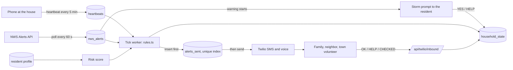
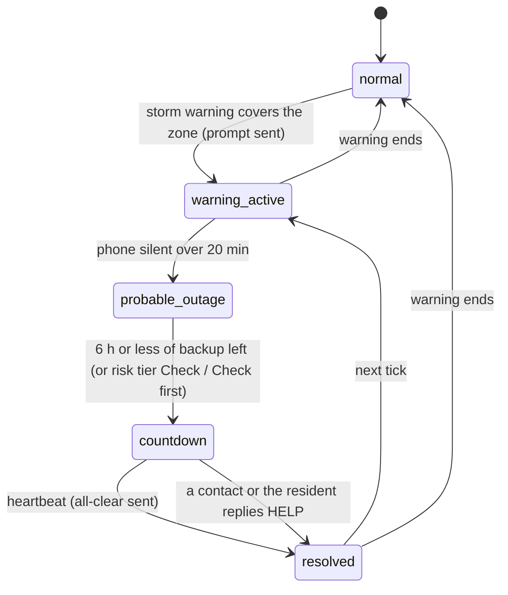

# Pilot Light

Pilot Light counts down a medically dependent rural senior's backup-battery hours during a winter power outage and texts and calls their family, a neighbor, and their town before the clock runs out.

The family member runs the app. The senior's side is one text or call when a storm warning starts, and nothing else.

## Run it

Needs Node 20+ and Postgres.

```bash
cp .env.example .env.local     # set DATABASE_URL; everything else is optional
createdb pilot_light
npm install
npm run setup                  # migrate + seed the Ossipee household and the storm scenario
npm run replay                 # the whole chain in the terminal, in about 2 minutes
npm run dev                    # web on :3000 plus the background worker
```

- `/replay` is the one-click demo: Run the storm, watch the countdown and the messages, Reset.
- `/h/00000000-0000-4000-8000-000000000001` is the seeded household's app: Home, People, Activity, House.
- `/h/new` sets up a household (sign in first; without an email service the sign-in link is shown on the page).
- `/town/Ossipee` is the volunteer roster.

Without Twilio keys every message is logged as `SIMULATED` and nothing is sent.

### Making real phones ring

1. Create a Twilio account and buy a US number. Start its A2P 10DLC registration (or toll-free verification) at once: carriers block or filter unregistered texting, and approval takes days.
2. Put `TWILIO_ACCOUNT_SID`, `TWILIO_AUTH_TOKEN`, `TWILIO_FROM` and your own numbers (`SEED_PHONE_1`, `SEED_PHONE_2`, `SEED_PHONE_3`, `SEED_PHONE_RESIDENT`) in `.env.local`, then `npm run db:seed`.
3. Expose the app (`ngrok http 3000`), set `PUBLIC_BASE_URL` to that https address, and point the number's incoming-message webhook at `PUBLIC_BASE_URL/api/twilio/inbound`.
4. `npm run twilio:check -- +1603…` checks the credentials and webhook and sends one test text and call.
5. `npm run replay`, then reply OK and HELP from the phones. Carriers treat HELP as a reserved keyword; confirm it reaches the app.

### Deploying

Vercel for the web app with `vercel.json`'s one-minute cron calling `/api/cron/tick` (set `CRON_SECRET`), Neon or Supabase for Postgres. Set `ADMIN_TOKEN` (protects `/replay` and the roster), `PUBLIC_BASE_URL`, the Twilio keys, `NWS_USER_AGENT`, and `RESEND_API_KEY` + `RESEND_FROM` for sign-in emails. Run `npm run db:migrate` against the hosted database once.

## How it works





The server never knows the power is out. It infers it from two signals agreeing: an active NWS warning (or Wind Advisory) over the household's zone, and the phone at the house going silent. Either alone does nothing. Both together for 20 minutes start a clock from the shortest backup among the household's devices.

**The risk score** decides how fast and how wide the ladder goes. It is built from named factors: cannot leave the house unassisted (+3), no backup power (+3), lives alone (+2), cannot reach the backup (+2), no reply to the storm prompt (+2), age 75–84 (+1) or 85+ (+2), replied ready to the storm prompt (−2). 3 or more is **Check**: the first alert goes out as soon as the outage is inferred and the town volunteer is included. 6 or more is **Check first**: everyone is alerted at once and the message leads with 911 guidance. Unable to leave and alone is always Check first. The People tab shows every factor, and the recommended contact escalates with the tier: first family contact, then the resident, then 911 with the nearest fire and police station and their drive times. The weights are our judgment, not a validated scale.

Pilot Light has to keep working during the event that takes down its own infrastructure, so it is built to assume its own failure:

1. **Inference from silence.** A dead-man's switch on the server; the household does nothing. `src/lib/engine/rules.ts`
2. **SMS and voice as the transport of last resort.** No app or push notification on the receiving end. `src/lib/twilio.ts`, `src/lib/messages.ts`
3. **Store-and-forward on the phone.** Heartbeats and battery edits made offline wait in IndexedDB and send when a connection returns. `src/lib/client/queue.ts`
4. **Idempotent delivery.** A unique index plus a claim lease means racing workers cannot text a family twice. `src/lib/engine/tick.ts`

Storm replay fakes the storm, not the system: it changes the alert, the heartbeat history, the storm-prompt answer and the clock speed, and the rules have no replay branch. `src/lib/replay.ts`

## Backtest

`npm run backtest` replays ten winters of real NWS events for all fifteen New Hampshire forecast zones (2016–2026, Iowa Environmental Mesonet archive), and `npm run backtest:outages` joins them to three years of real outages (DOE EAGLE-I county counts, 2023–2025). With the current arming set, Pilot Light's watch was armed at the start of 58% of outages that hit 10% or more of a county and 81% of those that hit 25%, including all twelve largest storms of the period; it misses most small outages, which happen outside any NWS product. An NH-01 household is on watch about 12 times a winter (168 hours) and the resident is asked the storm-prompt question about 5 times, with a median 16.7 hours of notice. The backtest changed the design: Wind Advisory was added to the arming set because it lifted coverage of major outages from 44% to 58%. Details, limits and method in [docs/backtest.md](docs/backtest.md).

## Code map

| Path | What it is |
|---|---|
| `src/lib/engine/rules.ts` | The outage rules as pure functions |
| `src/lib/engine/risk.ts` | The risk score, tiers and recommended contact |
| `src/lib/engine/tick.ts` | Loads households, applies the rules, sends the storm prompt, delivers alerts |
| `src/lib/inbound.ts` | OK / HELP / CHECKED / STOP replies, the resident's YES and HELP, voice key presses |
| `src/lib/nws.ts` | NWS alert poller, zone lookup, NH-only geocoding |
| `src/lib/nearby.ts` | Nearest fire, police and hospital with drive times |
| `src/lib/auth.ts` | Magic-link sign-in and household ownership |
| `src/lib/replay.ts` | Storm replay run and reset |
| `src/db/schema.ts` | Tables |
| `src/app/api/` | Route handlers, including the Twilio webhooks |
| `src/components/` | The household app (`HouseholdView`), setup steps, replay console, roster, map |
| `public/sw.js` | Offline shell and background heartbeat |
| `scripts/` | Worker, seed, migrate, replay CLI, backtest, Twilio check, one-time data pulls |
| `tests/` | Rule, risk and auth tests against fixtures |
| `docs/decisions.md` | Dated decisions and why |
| `docs/submission.md` | Draft answers for the App Challenge form |

## Data sources

| Source | Use |
|---|---|
| [NWS Alerts API](https://www.weather.gov/documentation/services-web-api) `alerts/active?area=NH` | Live trigger, polled every 60 s |
| NWS `points/{lat},{lng}` | Household's forecast zone, resolved at save |
| [Iowa Environmental Mesonet](https://mesonet.agron.iastate.edu/vtec/) VTEC archive | Ten winters of warnings for the backtest; the replayed Dec 28, 2025 Ossipee warning |
| [DOE / ORNL EAGLE-I](https://figshare.com/articles/dataset/24237376) | County outage counts every 15 minutes, 2023–2025, for the outage backtest |
| [NH GRANIT](https://nhgeodata.unh.edu/hosting/rest/services/Hosted) Political_Boundaries, NH_CAI_Locations | Town outlines; fire, police, hospital and urgent-care sites. Pulled once by `scripts/fetch-granit.mjs` into `public/data/` |
| [OpenFreeMap](https://openfreemap.org) | Street map tiles (dark style); falls back to town outlines offline |
| [OSRM](https://project-osrm.org) public router | Drive times to the nearest help; falls back to a straight-line estimate |
| OpenStreetMap Nominatim | Address to coordinates, restricted to NH |
| `src/data/utilities.json` | Utility registration links and a 10-town utility guess, hand-built and marked unverified |

## Limits, stated plainly

- **Background heartbeats do not run on iPhones.** The phone at the house checks in every 5 minutes while the app is open. Chrome on Android can also check in every 15 minutes in the background once installed. iOS Safari cannot, so an iPhone must keep the page open. A plug-in power sensor is the real fix and the planned next step.
- **Silence is weak evidence.** A phone can go quiet because it died or lost Wi-Fi. That is why a warning must also be in force, and why every alert asks the family to confirm.
- **Backup hours are estimates.** The defaults are starting points to be replaced with the figure for the actual equipment.
- **Drive times are clear-road estimates,** not emergency response times.
- **The utility-by-town list is a guess** until each row is confirmed with the utility.
- **Replay speeds up one shared clock.** Do not run it while real households are being monitored.
- Pilot Light is not a medical device and does not replace 911. Every message says so.

## Checks

```bash
npm test             # rules, risk score and auth helpers, against fixtures
npm run test:replay  # the full chain against Postgres with simulated transport
npm run backtest     # ten winters of NH warnings
npm run backtest:outages  # joined to three years of real outages
npm run lint && npm run typecheck && npm run build
```

## AI disclosure

This code was written with Claude Code from the team's build spec and design direction. Files it wrote carry an `// AI-assisted:` header. No AI runs in the product.
