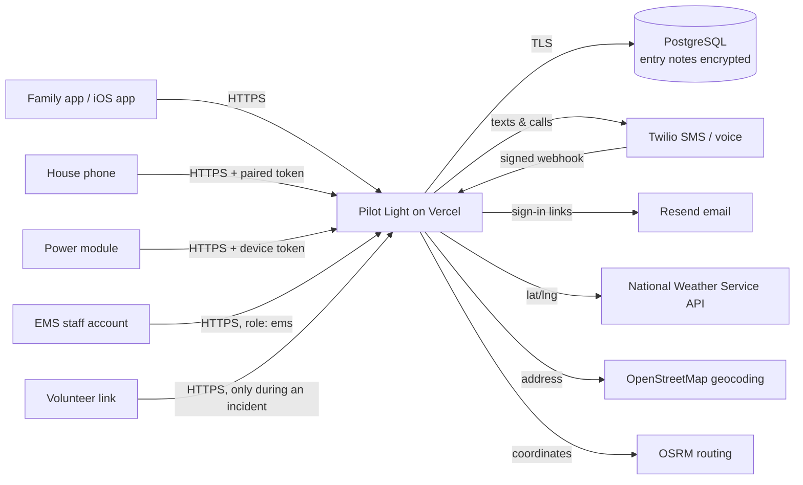

# Data inventory and flow

## What is stored

| Data | Example | Sensitivity | Stored | Who can see it |
|---|---|---|---|---|
| Household label, address, town, map position | "Mom's house", 1 Main St | High (location of a vulnerable person) | PostgreSQL | Owner; household contacts and EMS **during an incident** |
| Entry notes | "Side door; lockbox 4412; small dog" | **Highest** | PostgreSQL, **encrypted (AES-256-GCM)** | Owner; contacts and EMS during an incident (every EMS view and link opening audited) |
| Resident name, phone, birth year, lives alone, can leave unassisted | | High | PostgreSQL | Owner; contacts and EMS during an incident |
| Medical devices and battery hours | Oxygen concentrator, 4 h | High (health-related) | PostgreSQL | Owner; family contacts; EMS during an incident (not in volunteer texts) |
| Contacts: name, phone, priority | Daughter, +1 603… | Medium | PostgreSQL | Owner |
| Check-ins (heartbeats), power-module readings | timestamps, battery % | Low–medium | PostgreSQL | Owner, EMS |
| Alerts sent and replies | "OK 20" | Medium | PostgreSQL | Owner, EMS |
| Staff accounts | email, role, town | Medium | PostgreSQL | Administrator |
| Audit log | who viewed what, when; hashed IP | Medium | PostgreSQL (append-only) | Administrator |
| Session and sign-in tokens | | Secret | PostgreSQL, **hashed only** | Nobody |
| House-phone and power-module tokens | | Secret | PostgreSQL, **hashed only** | Nobody |

Not collected: diagnoses, insurance, Social Security numbers, payment information.

## Where data goes

Third parties receive only what their job needs: Twilio gets the phone number and message text (volunteer texts are minimized); the weather service gets map coordinates; the geocoder gets the typed address once, when the household is saved; the routing service gets coordinates for drive times. For a department pilot, see [vendor-checklist.md](vendor-checklist.md) for which of these need agreements or replacement.

## Retention

- Household data: until the owner deletes the household (one tap; cascades to everything attached).
- Audit log: kept for 2 years, then deleted (to be confirmed with the partner department's records policy).
- Sign-in links: 15 minutes, single use. Sessions: 30 days. Administrator sign-in: 12 hours.
